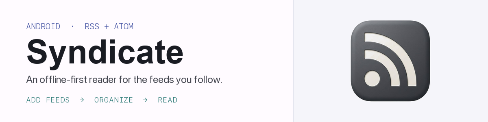

<p align="center">
  
</p>

Syndicate is a native Android reader for RSS and Atom feeds. Articles are stored locally, read state is kept per article, and feeds can be grouped into folders so you can follow what matters without depending on a network connection.

## Features

- Add feeds by URL (RSS 2.0 and Atom), with duplicate detection and a fetch preview
- Group feeds with multiple tags per feed
- Unread badges scoped to the current focus: all articles, one feed, or a tag
- Mark a single article read, or mark all articles in the current focus read
- Heart articles in the reader and find them again in the Favourites category
- Manual refresh, plus optional refresh on startup
- Sort articles, feeds, and tags by name, date, or unread count
- In-app reader with font and size options, and a link to the original page
- Light, dark, and system themes with Material You dynamic color on supported devices
- Export and import subscriptions as OPML

## Install

Syndicate requires Android 7.0 (API 24) or later. Download `syndicate.apk` from the [latest release](https://github.com/russelldickenson/syndicate/releases/latest) and open it on your device to install. Android will ask you to allow installation from unknown sources.

If the device is connected to a computer, install the downloaded file with:

```bash
adb install syndicate.apk
```

Building from source is not required to use the app.

## Authors

- [Russell Dickenson](https://github.com/russelldickenson)

Agentic coding tools were used for coding.

## License

Syndicate is licensed under the [GNU General Public License v3.0](https://www.gnu.org/licenses/gpl-3.0.html).
